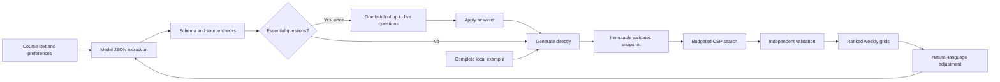

# Architecture

CourseFit uses Node.js 22+ built-ins and browser-native JavaScript/CSS. The language step extracts data; a deterministic solver generates and ranks timetables. No build pipeline, database or dependency installation is required.

## Generation flow

The browser never requires a confirmation checkbox. A Generate or Update request authorizes solving. `workflow.js` separates factual blockers from infeasibility: unavailable semester sections or genuinely missing times produce `status: "needs_data"` and an adjustment box, not fabricated times or another question screen. Optional unresolved interpretations appear as notes.

## Plan and online normalization

The four required plan arrays are `courses`, `hardConstraints`, `softPreferences` and `clarifications`. Courses have unique codes and section IDs; each section contains all required weekly meetings. Section metadata can include `semester: 1 | 2` and `asynchronous: true`.

There are no course, section or meeting count caps. Generation rejects mixed semesters and unknown meeting facts. The public input budget is 100,000 characters and JSON request bodies are limited to 2 MB; provider context/output limits still apply.

Schema normalization recognizes 00:00–08:00 and 00:00–08:20 catalogue slots as online placeholders, including missing-day rows and equivalent unpadded times. Purely online sections use `asynchronous: true, meetings: []`. In mixed bundles, only the online placeholder is removed; real weekly meetings remain. Other missing times are never assumed online.

Every model-extracted course, section and rule needs a short contiguous `evidence` quote. The parser anchors quotes to the supplied source, accepting formatting-only whitespace, dash, quotation-mark and full-width ASCII variations. This does not independently prove the semantic accuracy of extracted times. Examples are pre-parsed and need no model call.

## One question round and adjustments

The prompt requests concise, consolidated questions, usually 3–5 for an ambiguous catalogue and fewer when sufficient. Deterministic checks cover missing facts and mixed semesters, avoid duplicating missing-course questions, and bound the displayed batch to five without discarding issues.

After answering or skipping optional questions, generation clears the question queue and exposes unresolved notes or factual blockers. It never opens another required question round. No course is silently omitted to make a schedule feasible.

Adjustments send the original source plus the current plan and latest requested change. The current plan is authoritative: superseded restrictions must be removed, unaffected courses/sections/preferences retained, and previously removed courses must not be restored from the original text. Sources, answers and adjustments are retained separately, avoiding recursive prompt growth. A failed update preserves the previous browser result and edit text.

## Search and independent checks

Each course is a variable and sections are its domain. Backtracking uses minimum remaining values and forward checking. Internally overlapping sections are excluded. Online sections are selected without adding calendar intervals.

Earliest/latest times, blocked intervals, day off, minimum break and maximum class days can prune partial assignments. Maximum gap cannot: a later course might fill a gap. This holds inside AND/OR rules.

The search keeps at most 20 candidates and has a four-second budget. Completed searches return exact counts, score frequencies and ordering. If the budget is reached, `searchComplete: false` means feasible counts are lower bounds and ranking covers explored combinations only. No-result partial searches are distinguished from proven infeasibility. Equal scores use deterministic course/section identifiers.

Every returned candidate passes `validator.js`, which independently resolves membership, checks overlaps using arrival/departure events and evaluates hard rules. Departures precede arrivals at the same minute, allowing adjacent classes unless a break rule forbids them.

The independent exhaustive reference in `evaluation/reference.js` does not import solver search, pruning or scoring. Fixed cases have manually specified feasible counts.

## HTTP interface

| Endpoint | Contract |
| --- | --- |
| `GET /api/health` | Server health. |
| `GET /api/config` | Model and redacted key status. |
| `PUT /api/config` | Save key/model locally or in session; does not call the provider. |
| `DELETE /api/config` | Remove saved settings, restoring environment defaults. |
| `GET /api/examples` | Example descriptions and original text. |
| `POST /api/generate` | `{input}` starts; `{exampleId}` loads an example; `{draftId,answers}` applies the single question batch; `{draftId,adjustment}` updates a result. Returns `{draft,result?,confirmationId?}`. |
| `POST /api/explain` | `{confirmationId,scheduleId}` adds optional commentary about verified facts. |

The snapshot identifier retains its legacy `confirmationId` name internally; there is no additional confirmation UI. Lower-level `/api/parse`, `/api/examples/load`, `/api/clarify`, `/api/confirm` and `/api/solve` remain for compatibility and module-level integration checks. The browser uses `/api/generate` throughout.

Drafts, snapshots and cached results are bounded to 100 entries and expire after two hours. A server restart removes them. Keys are never returned or included in exports. Saved files use owner-only permissions and stay outside the static allowlist and Git.

## Model and local server boundary

Only one provider request runs at a time. Requests use the provider's configured HTTPS endpoint, JSON mode and a 90-second timeout. Invalid schema or quotes receive at most one correction attempt. Empty, malformed or truncated JSON fails safely. Provider bodies and credentials never enter client error messages.

The server binds to IPv4 loopback and rejects foreign hosts/origins. Mutation endpoints require JSON. There is no multi-user authentication; this is a local workspace, not a public hosted service. Optional model commentary is labelled and never changes solver facts or scores.
